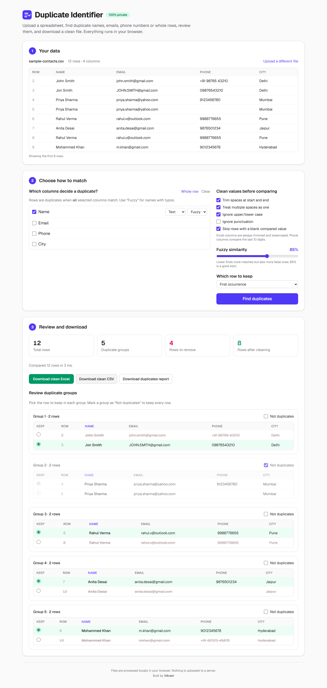

# Duplicate Identifier

Upload a spreadsheet, find duplicate names, emails, phone numbers or whole rows, review them, and download a clean file.

**Everything runs in your browser.** Files are never uploaded to a server.

Built by **Vikram**.



## Features

- **Many file types.** Excel (`.xlsx`, `.xls`, `.xlsm`, `.xlsb`), OpenDocument (`.ods`), `.csv`, `.tsv`, `.txt` and `.json`.
- **Multiple sheets.** Pick which sheet of a workbook to clean.
- **Choose the columns that decide a duplicate.** Rows are duplicates when all selected columns match. One click selects the whole row.
- **Exact or fuzzy matching per column.** Fuzzy matching catches typos like `Jon Smith` vs `John Smith` and ignores word order, so `Smith John` matches too.
- **Smart value cleaning.**
  - Emails are trimmed and lowercased: ` JOHN@Gmail.com ` equals `john@gmail.com`.
  - Phone numbers compare the last 10 digits: `+91 98765-43210` equals `09876543210`.
  - Text can ignore case, extra spaces and punctuation.
- **Pick the row to keep.** First, last, or the most complete row. You can override this for each group.
- **Review screen.** Change the kept row or mark a group as "Not duplicates".
- **Professional Excel downloads.**
  - The clean workbook has a styled "Clean Data" sheet with a coloured frozen header, filters, banded rows, fitted column widths and formatted dates.
  - A "Summary" sheet shows the source file, matching rules and results.
  - A "Removed Rows" sheet lists every removed row and the row it duplicated.
  - The duplicates report colour-codes each row as Keep, Remove or Not duplicate.
  - Every sheet is set up to print landscape, fitted to page width.
- **CSV download.** A plain clean CSV is also available.
- **Stays responsive.** Detection runs in a Web Worker with a progress bar and a cancel button.
- Light and dark mode, keyboard accessible, works on phones.

## Tech stack

| Part | Technology |
|---|---|
| Framework | Next.js 16 (App Router) with React 19 and TypeScript |
| Styling | Tailwind CSS 4 |
| Reading files and CSV export | SheetJS (`xlsx` 0.20.3 from the official SheetJS CDN) |
| Styled Excel export | ExcelJS 4.4, loaded only when you download |
| Duplicate detection | Custom TypeScript: trigram index, Levenshtein similarity, union-find grouping |
| Background processing | Web Worker |
| Tests | Node.js built-in test runner |

The original plan used Fuse.js for fuzzy matching. Fuse.js is built for search boxes, and comparing every row against every other row with it took over 100 seconds for 20,000 rows. It was replaced with a trigram index, which is much faster and found every match that a full pairwise comparison found in testing.

## Getting started

You need Node.js 20 or newer.

```bash
npm install
npm run dev
```

Open http://localhost:3000 and click **Try the sample contacts file** to see it work.

Other commands:

```bash
npm test          # run the duplicate-detection unit tests
npm run lint      # check code style
npm run check     # lint + type check + tests + build, run before deploying
npm run build     # build the static site into out/
npm run preview   # serve out/ at http://localhost:3000
```

## Deployment

The app has no server code. `npm run build` creates a static website in the `out/` folder that any static host can serve.

- **Vercel.** Import the repository at vercel.com. Vercel detects Next.js and needs no settings. Set the Root Directory to `Duplicate_identifier` if the app sits in a sub-folder of the repository.
- **Netlify.** Import the repository. The included `netlify.toml` sets the build command and the `out` publish folder.
- **Any web server or CDN.** Run `npm run build` and upload the contents of `out/`.

The app must be served from the root of a domain, such as `https://dedupe.example.com/`. Hosting under a sub-path like GitHub Pages project sites needs `basePath` set in `next.config.ts`.

## How it works

```
File  ->  SheetJS reads it into rows  ->  you pick columns and options
                                                   |
                                         Web Worker runs detection
                                                   |
      1. Normalize each compared value (trim, lowercase, phone digits...)
      2. Group rows whose exact-match columns are identical
      3. Inside each group, find fuzzy matches:
           - a trigram index finds candidate pairs that share enough 3-letter chunks
           - Levenshtein similarity confirms each candidate on every fuzzy column
      4. Join matching rows into duplicate groups and pick a row to keep
                                                   |
Review screen  ->  download clean file and duplicates report
```

Tip: combining an exact column with a fuzzy one, such as exact City and fuzzy Name, is faster and gives fewer false matches.

## Performance

Measured in Node.js on a typical laptop:

| Data | Mode | Time |
|---|---|---|
| 100,000 rows | Exact match on email | 0.2 s |
| 110,000 mostly unique names | Fuzzy match on name | 18 s |

Browser speed is similar. Files above about 100,000 rows work for exact matching. Fuzzy matching on very large files can take a while, and the app shows a warning.

## Project structure

```
src/
├── app/
│   ├── layout.tsx          # Page shell and metadata
│   ├── page.tsx            # Upload, match settings, results (main flow)
│   └── globals.css
├── components/
│   ├── FileDrop.tsx        # Drag-and-drop upload
│   ├── DataTable.tsx       # Preview and group tables
│   ├── ConfigPanel.tsx     # Column and matching settings
│   └── ResultsPanel.tsx    # Stats, review, downloads
└── lib/
    ├── types.ts            # Shared types
    ├── files.ts            # Read files and export results (SheetJS)
    ├── normalize.ts        # Value cleaning rules
    ├── similarity.ts       # Levenshtein and word-order-free similarity
    ├── dedupe.ts           # Duplicate detection engine
    ├── dedupe.worker.ts    # Runs detection off the main thread
    └── dedupe.test.ts      # Unit tests
public/
└── sample-contacts.csv     # Demo data
scripts/
└── preview.mjs             # Local server for the static build
docs/
└── screenshot.png
netlify.toml                # Netlify build settings
```

## Known limits

- Phone matching compares the last 10 digits. That suits India and North America but may merge different numbers in countries with longer local numbers.
- Very common three-letter chunks are skipped when looking for fuzzy candidates in huge files. In rare cases this can miss a match.
- Very large files are limited by browser memory.

## Roadmap

- [ ] Merge duplicate rows into one record instead of only removing
- [ ] Save and reuse matching settings
- [ ] Clean all sheets of a workbook at once
- [ ] Optional server mode for files with millions of rows

## License

MIT. Built by Vikram.
